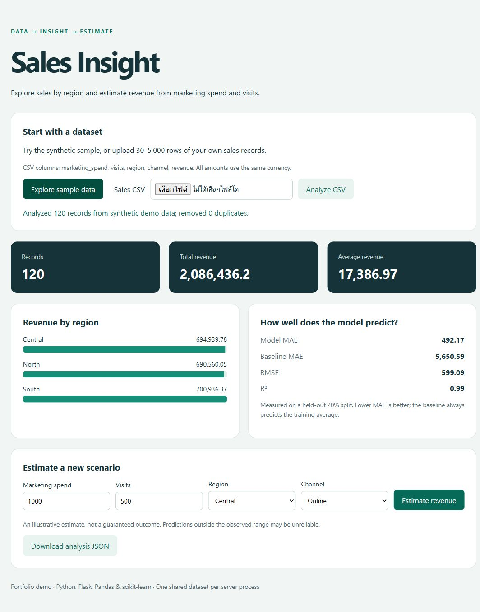

# Sales Insight Dashboard

A local web application that turns sales CSV records into regional revenue summaries, a regression evaluation, and interactive revenue estimates. The full flow is CSV ingestion → validation/deduplication → preprocessing → training → report → prediction API/dashboard.

## Project preview

[Open the public interactive demo](https://jakkrapat-project-lab.happy-bud-2264.chatgpt.site/#sales)



The public preview computes revenue estimates in the browser using exported parameters from the fitted Python Ridge model. The full Python app supports CSV upload, preprocessing, training, and analysis reports.

## Run locally

Python 3.11+ (PowerShell):

```powershell
python -m venv .venv
.\.venv\Scripts\python.exe -m pip install -e ".[dev]"
.\.venv\Scripts\python.exe -m flask --app data_app run --port 5000
```

Open [http://127.0.0.1:5000](http://127.0.0.1:5000), click **Explore sample data**, then try a prediction or download the JSON analysis. The bundled 120-row sample is explicitly synthetic, generated with seed 42 by `python scripts/generate_demo.py`.

## CSV format

```csv
marketing_spend,visits,region,channel,revenue
1000,500,Central,Online,8100
1200,650,North,Retail,9050
```

Upload 30–5,000 rows (at least 30 distinct records), up to 5 MiB. Numeric values must be finite and non-negative; revenue and categories are required. Missing marketing_spend/visits values are imputed using training medians. Categories support at most 50 distinct values each. Exact duplicates across the five modeled columns are removed. Use a consistent currency and one comparable period per row.

## Model and API

A fixed 80/20 split separates training from evaluation. A ColumnTransformer fits numeric imputation/scaling and one-hot categorical encoding on training data only, followed by Ridge regression. The dashboard reports MAE, RMSE, R², and the MAE of a training-average baseline. Estimates are clamped to zero; prediction requests use known categories.

| Method | Route | Purpose |
|---|---|---|
| GET | / | Dashboard |
| POST | /api/demo | Analyze bundled synthetic CSV |
| POST | /api/analyze | Analyze multipart CSV in field file |
| GET | /api/report | Current report as JSON |
| POST | /api/predict | Estimate revenue from four feature values |
| GET | /health | Process health |

Prediction body: `{"marketing_spend":1000,"visits":500,"region":"Central","channel":"Online"}`. No model/report yet returns 409; invalid input returns 400; oversized uploads return 413. Errors follow `{"error":{"code":400,"message":"..."}}`.

## Verify

```powershell
.\.venv\Scripts\python.exe -m pytest -q
.\.venv\Scripts\ruff.exe check .
.\.venv\Scripts\ruff.exe format --check .
```

Tests cover the complete demo/prediction flow, deduplication, missing-value handling, invalid uploads, report preservation after a failed analysis, limits, and repeatable metrics. Static assets, templates, and sample CSV are included in the Python package.

## Limits

The latest dataset/model is held in memory and shared by all visitors to one server process; restart clears it. This is a localhost portfolio demo, with no user isolation or production persistence. Synthetic results do not demonstrate business impact. Predictions are illustrative, especially outside the training range. A random row split is unsuitable for chronological forecasting; dated sales data needs a time-based split.

Study notes: [docs/learning.md](docs/learning.md).

## Optional GitHub Actions CI

[docs/ci.yml](docs/ci.yml) contains a ready-to-use workflow for Python 3.11–3.13. It is a template, not an active workflow. To enable it, copy it to `.github/workflows/ci.yml` using a GitHub credential with workflow write permission. The current publishing credential lacks that permission; local checks were run successfully.
