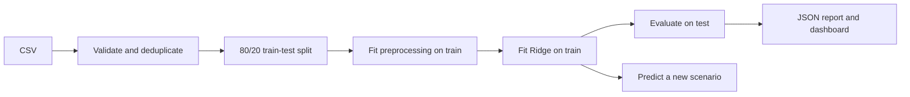

# Sales Insight Dashboard — เรียนระบบข้อมูลและการทำนายตั้งแต่ศูนย์

คู่มือนี้ใช้โค้ดใน repo `sales-insight-dashboard` สอนตั้งแต่ตารางข้อมูลจนถึงเว็บที่เรียกโมเดลได้ โฟลเดอร์ในเครื่องปัจจุบันชื่อ `end-to-end-data-driven-app` ไม่ต้องรู้ machine learning มาก่อน แต่ควรลอง Python function และ dict ขั้นพื้นฐาน

## 1. ภาพรวม: ระบบนี้แก้ปัญหาอะไร

ถ้ามีตารางยอดขาย เราอาจอยากรู้ว่าแต่ละภูมิภาคมีรายได้เท่าไร และถ้าเปลี่ยนงบการตลาดหรือจำนวนผู้เข้าชม รายได้น่าจะอยู่ประมาณไหน

แอปนี้ทำสองงานที่ต่างกัน:

1. **Analytics:** สรุปข้อมูลที่มีอยู่จริง เช่นผลรวมรายได้แต่ละ region
2. **Prediction:** ใช้รูปแบบที่เรียนจากข้อมูลเพื่อประมาณรายได้ของ input ใหม่

ผลรวมจาก Pandas ไม่ใช่ผลทำนายจาก ML และกราฟสวยไม่ได้แปลว่าโมเดลทำนายดี ต้องอ่าน metrics บนข้อมูลที่ไม่ได้ใช้ฝึกด้วย


## 2. What / Why / How

| ส่วน | What: ทำอะไร | Why: ทำไมต้องมี | How: ในระบบนี้ |
|---|---|---|---|
| Ingestion | อ่าน CSV เข้าระบบ | รับข้อมูลจากผู้ใช้ได้ | `read_sales()` อ่าน bytes ด้วย Pandas |
| Validation | ตรวจ schema และค่า | ข้อมูลผิดทำให้ผลลัพธ์ผิดหรือฝึกไม่ได้ | ตรวจ field, จำนวนแถว, missing และ infinity |
| Preprocessing | แปลงข้อมูลให้โมเดลใช้ได้ | มีทั้งเลข หมวดหมู่ และ missing values | imputer, scaler และ one-hot encoding |
| Training | เรียนค่าพารามิเตอร์ | ไม่ต้องตั้งสูตรรายได้เองทั้งหมด | Ridge regression บน training rows |
| Evaluation | วัดความคลาดเคลื่อน | แยกการจำข้อมูลออกจากความสามารถทำนาย | MAE/RMSE/R² บน held-out rows |
| Serving | รับ input ใหม่แล้วคืน prediction | ให้คนใช้โมเดลผ่านเว็บได้ | Flask `/api/predict` |

คำว่า end-to-end ในบริบทนี้หมายถึงมีเส้นทางตั้งแต่ข้อมูลเข้าไปจนเกิดผลที่ผู้ใช้เห็น ไม่ได้หมายความว่าระบบ production ครบทุกด้าน

## 3. พื้นฐานข้อมูล: จาก CSV ไปเป็น X และ y

CSV คือข้อความที่คั่นแต่ละคอลัมน์ด้วย comma แถวแรกเป็นชื่อคอลัมน์ เช่น:

```csv
marketing_spend,visits,region,channel,revenue
1000,500,Central,Online,8100
1200,650,North,Retail,9050
```

นี่เป็น **ตัวอย่างรูปแบบเพียงสองแถว** อัปโหลดจริงต้องมีอย่างน้อย 30 distinct records ตัวอย่างข้างบนจึงยังฝึกแอปไม่ได้

Pandas อ่านเป็น **DataFrame** ซึ่งเป็นตารางที่มีแถวและคอลัมน์ หนึ่งแถวควรเป็นหน่วยข้อมูลที่เปรียบเทียบกันได้ เช่นยอดขายของหนึ่งช่วงเวลา ไม่ควรผสมยอดรายวันกับรายเดือนโดยไม่ปรับความหมาย

| คอลัมน์ | ชนิด/บทบาท | ความหมาย |
|---|---|---|
| marketing_spend | ตัวเลข; feature | งบการตลาด |
| visits | ตัวเลข; feature | จำนวนการเข้าชม |
| region | หมวดหมู่; feature | ภูมิภาค |
| channel | หมวดหมู่; feature | ช่องทาง เช่น Online/Retail |
| revenue | ตัวเลข; target | รายได้ที่ต้องการให้โมเดลประมาณ |

**Feature หรือ X** คือข้อมูลที่โมเดลใช้เป็นตัวตั้ง **Target หรือ y** คือคำตอบที่ใช้สอนโมเดล การฝึกแบบนี้เรียกว่า supervised learning เพราะมี input คู่กับคำตอบเดิม และการทำนายค่าตัวเลขต่อเนื่องเรียกว่า regression

ตอนทำนายไม่ส่ง revenue เพราะนั่นคือสิ่งที่ยังไม่รู้ ถ้าเผลอเอา revenue เป็น feature โมเดลจะได้รับคำตอบก่อนสอบ เกิด data leakage

สำหรับคนเริ่ม Python: `import pandas as pd` นำ Pandas มาใช้ผ่านชื่อย่อ `pd` `def analyze(content)` ประกาศ function รับข้อมูลและคืนผล `frame["revenue"]` เลือกคอลัมน์ ส่วน `report` เป็น dict ที่เก็บชื่อหัวข้อคู่กับผลลัพธ์ ฟังก์ชันแยกขั้นตอนเพื่อให้ตรวจและใช้ซ้ำได้

## 4. เครื่องมือและตำแหน่งโค้ด

| เครื่องมือ/ไฟล์ | ใช้ทำอะไร |
|---|---|
| Python | ควบคุมลำดับการประมวลผล |
| Pandas | อ่าน ตรวจ และรวมข้อมูลตาราง |
| NumPy | คำนวณตัวเลขและตรวจ infinity/finite values |
| scikit-learn | preprocessing, split, Ridge และ metrics |
| Flask | หน้าเว็บและ API |
| HTML/CSS/JavaScript | UI, graph และ `fetch()` รับ JSON |
| pytest / Ruff | ตรวจพฤติกรรมและรูปแบบโค้ด |
| Git / GitHub | ประวัติ source และการเผยแพร่ repo |
| `src/data_app/pipeline.py` | `read_sales()`, `analyze()`, `predict()` |
| `src/data_app/__init__.py` | application factory และ HTTP endpoints |
| `src/data_app/data/demo_sales.csv` | ข้อมูลสังเคราะห์ 120 แถว |
| `scripts/generate_demo.py` | สร้างข้อมูลตัวอย่างด้วย seed 42 |
| `src/data_app/static/app.js` | ปุ่ม วิเคราะห์ แสดงผล และทำนาย |
| `examples/demo_report.json` | ผลรันตัวอย่างที่บันทึกไว้ |
| `tests/test_app.py` | ตรวจ workflow และ input ที่ไม่ถูกต้อง |

หน้าเว็บสาธารณะใช้ **Sites** สำหรับ hosting และใช้พารามิเตอร์โมเดลที่ export จาก Python โค้ดสร้างกราฟภาพประกอบใช้ Matplotlib ใน workspace แต่ Flask แอปนี้ไม่ได้ต้องใช้ Matplotlib เพื่อทำงาน

## 5. Step by step: รันครั้งแรก

### ขั้นที่ 1 — เข้า repo และเตรียม Python

จากโฟลเดอร์ `ProfileProject`:

```powershell
Set-Location .\end-to-end-data-driven-app
python --version
python -m venv .venv
.\.venv\Scripts\python.exe -m pip install -e ".[dev]"
```

ใช้ Python 3.11+ ถ้า clone ใหม่ให้เข้า `sales-insight-dashboard` แทน `.venv` แยก library ของโปรเจกต์ และ editable install (`-e`) ทำให้ import source ใน `src` ได้ `[dev]` เพิ่มเครื่องมือทดสอบ

ถ้าใช้ environment ร่วมที่มีอยู่แล้วในเครื่องนี้ ให้แทน `.\.venv\Scripts\python.exe` ด้วย `..\.venv\Scripts\python.exe` หลังเข้า repo ไม่ต้องสร้างและติดตั้งซ้ำ

### ขั้นที่ 2 — เริ่ม Flask

```powershell
.\.venv\Scripts\python.exe -m flask --app data_app run --port 5000
```

เปิด `http://127.0.0.1:5000` Terminal ต้องเปิดค้างไว้ และ `Ctrl+C` หยุด server ได้ ถ้า port ถูกใช้อยู่ ให้เปลี่ยนทั้งคำสั่งและ URL เป็น port อื่น

### ขั้นที่ 3 — เริ่มด้วย sample

กด **Explore sample data** ระบบจะอ่าน CSV สังเคราะห์ ตรวจข้อมูล ฝึกโมเดล และแสดงรายงาน ตัวอย่างนี้ไม่ได้มาจากยอดขายบริษัทจริง

ในผลที่บันทึกไว้มี 120 แถว แบ่งฝึก 96 แถวและทดสอบ 24 แถว MAE ประมาณ 492.17 เทียบ mean baseline ประมาณ 5,650.59 ตรวจตัวเลขได้จาก `examples/demo_report.json` ค่าเหล่านี้เป็นผลของชุดสังเคราะห์ ไม่ใช่หลักฐานว่าช่วยบริษัทเพิ่มรายได้

### ขั้นที่ 4 — เปลี่ยน scenario และดาวน์โหลด

ลอง spend = 1000, visits = 500, region = Central, channel = Online ค่าจากโมเดลที่บันทึกไว้ประมาณ 8,726.69 หน่วยเดียวกับ revenue จากนั้นเพิ่ม visits แล้วกด Estimate ใหม่ สังเกตว่าผลเปลี่ยนอย่างไร

กด Download analysis JSON แล้วอ่าน `metrics`, `regions`, `train_rows` และ `holdout` จะเห็นว่าหน้าเว็บใช้ข้อมูลจริงจากรายงาน ไม่ได้ใส่ตัวเลขกราฟตายตัวเอง

### ขั้นที่ 5 — ลอง CSV ของตัวเอง

เตรียมไฟล์ UTF-8 ที่มีห้าคอลัมน์ตามตารางและ 30–5,000 แถว มีอย่างน้อย 30 แถวที่ไม่ซ้ำกัน ขนาด request จำกัด 5 MiB เลือก Sales CSV แล้วกด Analyze CSV ฟีเจอร์อัปโหลดนี้อยู่ในแอป Python ที่รันในเครื่อง

## 6. กระบวนการภายในทีละขั้น



### 6.1 อ่านและตรวจข้อมูล — `read_sales()`

โค้ดรับ bytes แล้วอ่าน CSV ไม่ได้เก็บไฟล์อัปโหลดไว้บน disk จากนั้นเลือกเฉพาะห้าคอลัมน์ที่ใช้ คอลัมน์อื่นไม่เข้าสู่โมเดล

- marketing_spend, visits และ revenue ต้องแปลงเป็นเลขได้และไม่ติดลบหรือเป็น infinity
- revenue และหมวดหมู่ห้ามหาย ตัวเลข feature บางแถวหายได้ แต่ห้ามหายทั้งคอลัมน์
- region/channel trim ช่องว่าง ต้องมี 1–80 ตัวอักษร และไม่เกิน 50 หมวดหมู่ต่อคอลัมน์
- ลบแถวที่เหมือนกันทั้งห้าคอลัมน์แล้วตรวจจำนวน distinct rows อีกครั้ง
- revenue ต้องมีมากกว่าหนึ่งค่าเพื่อให้การประเมิน regression มีความหมาย

การ deduplicate เป็นนโยบายของ demo ถ้าเป็นยอดขายจริง สองรายการที่ข้อมูลเหมือนกันอาจเป็นคนละ transaction ได้ ควรมี ID และกำหนดนโยบายตามธุรกิจ ไม่ลบทิ้งเพราะหน้าตาเหมือนกันอย่างเดียว

### 6.2 แบ่งข้อมูลก่อนเรียนรู้

```python
x_train, x_test, y_train, y_test = train_test_split(
    frame[FEATURES], frame[TARGET], test_size=0.2, random_state=42
)
```

Training set เปรียบเหมือนชุดฝึกทำโจทย์ ส่วน test set เป็นข้อสอบที่กันไว้ หากคำนวณ preprocessing จากข้อมูลทุกแถวก่อน split เราจะเผลอใช้ข้อมูลข้อสอบช่วยฝึก

`random_state=42` ช่วยให้แบ่งซ้ำแบบเดิมกับข้อมูลและสภาพแวดล้อมเดิม ไม่ได้ทำให้ผลดีโดยอัตโนมัติ และการทดลองเพียงหนึ่ง split ไม่บอกว่าผลจะคงที่กับทุกชุดข้อมูล

### 6.3 Imputation — เติมค่าที่หาย

`SimpleImputer(strategy="median")` เรียน median จาก training rows เช่นค่าที่พบ `[10, 20, 100]` มี median 20 จึงแทนช่องว่างด้วย 20 ตัวอย่างนี้อธิบายหลักการ ไม่ใช่ median จริงของ CSV ตัวอย่าง

### 6.4 Scaling — ปรับสเกล

`StandardScaler` คำนวณประมาณ `z = (x - training_mean) / training_std` ทำให้เลขต่างหน่วยไม่ถูกลงโทษด้วย Ridge อย่างไม่สมดุลเพียงเพราะมีขนาดใหญ่กว่า mean/std เรียนจาก train แล้วนำชุดเดิมมาใช้กับ test และ input ใหม่

### 6.5 One-hot encoding — แปลงหมวดหมู่

ถ้ามี North, Central, South เราสร้างคอลัมน์ตัวบ่งชี้ว่าอยู่หมวดใด แทนการใช้ North = 1, Central = 2, South = 3 เพราะเลขแบบหลังทำให้เกิดความหมายของลำดับ/ระยะห่างที่ไม่ได้มีจริง

`ColumnTransformer` ใช้เส้นทางตัวเลขกับสอง numeric features และ one-hot กับ region/channel แล้วรวมเป็น input ของโมเดล ส่วน `Pipeline` ผูก preprocessing และโมเดลไว้ด้วยกัน

### 6.6 Ridge regression — เรียนสูตรประมาณค่า

แนวคิดของโมเดลคือ `prediction = intercept + ผลรวม(coefficient × transformed_feature)` ค่าพารามิเตอร์เรียนจากข้อมูล ไม่ใช่สูตรธุรกิจที่เรารู้แน่นอนก่อนฝึก

Ridge พยายามลดผลรวม squared errors พร้อมเพิ่ม penalty ต่อ coefficient ขนาดใหญ่ ช่วยควบคุมความซับซ้อน โค้ดใช้ `alpha=1.0` แบบคงที่ ยังไม่มีการเลือก alpha ด้วย cross-validation และ coefficient ไม่ได้พิสูจน์เหตุและผล เช่นเพิ่ม spend แล้วรายได้จริงจะเพิ่มเท่านี้เสมอ

## 7. อ่าน metrics ให้เป็น

สมมติค่าจริง `[100, 200]` และทำนาย `[110, 180]` เป็นตัวอย่างสอนคำนวณ:

| Metric | ความหมาย | ตัวอย่าง/ข้อควรเข้าใจ |
|---|---|---|
| MAE | ค่าเฉลี่ย absolute error | `(10 + 20) / 2 = 15`; หน่วยเดียวกับ revenue |
| RMSE | รากที่สองของค่าเฉลี่ย squared error | `sqrt((100 + 400) / 2)` ≈ 15.81; ไวต่อ error ใหญ่ |
| R² | เปรียบ squared error กับความแปรปรวนของ y | 1 คือพอดีทุกแถว; อาจติดลบได้ ไม่ใช่เปอร์เซ็นต์ accuracy |
| Baseline MAE | error ของโมเดลที่ง่ายมาก | ที่นี่ทายค่าเฉลี่ย revenue ของ train ทุกแถว |

R² = 0 อ้างอิงการทายค่าเฉลี่ยของชุดที่ประเมิน ขณะที่ DummyRegressor ในแอปใช้ค่าเฉลี่ยของ **train** จึงไม่ใช่ว่าค่า MAE ของ baseline ต้องตรงกับ R² = 0 ทุกครั้ง

ข้อมูลสังเคราะห์มีความสัมพันธ์ที่ผู้สร้างกำหนดไว้ จึงเรียนง่ายกว่าธุรกิจจริง ถ้าข้อมูลเป็น time series ควรแยกตามเวลา ไม่ random split แล้วอ้างเป็นการพยากรณ์อนาคต

## 8. เรียก API ด้วยตัวเอง

เปิด PowerShell อีกหน้าต่างขณะ server ยังทำงาน:

```powershell
# วิเคราะห์ sample ก่อน เพื่อให้มี model
Invoke-RestMethod 'http://127.0.0.1:5000/api/demo' -Method Post

# ทำนาย scenario ใหม่
$scenario = '{"marketing_spend":1000,"visits":500,"region":"Central","channel":"Online"}'
Invoke-RestMethod 'http://127.0.0.1:5000/api/predict' -Method Post -ContentType 'application/json' -Body $scenario

# อ่านรายงานล่าสุด
Invoke-RestMethod 'http://127.0.0.1:5000/api/report'
```

`/api/predict` ต้องส่งสี่ field เท่านั้น numeric input ต้องเป็นเลข finite ระหว่าง 0 กับ 1,000,000,000 และหมวดหมู่ต้องอยู่ในรายงาน dataset ปัจจุบัน ถ้ายังไม่ analyze จะได้ 409, input ผิดได้ 400, request ใหญ่เกินขอบเขตได้ 413

OneHotEncoder ภายในตั้งให้ ignore หมวดที่ไม่เคยเห็นระหว่าง fit แต่ API ยังตรวจไม่ให้ส่งหมวดนอก dataset หมวดที่มีเฉพาะใน test split อาจถูก encoder แทนด้วยศูนย์ทั้งหมด เพราะไม่ได้เห็นใน train

## 9. State, หน่วยความจำ และเว็บสาธารณะ

`Analysis` เป็น dataclass เก็บ `model` กับ `report` คู่กัน แอปเก็บผลล่าสุดใน `app.extensions["analysis"]` ซึ่งอยู่ในหน่วยความจำ เมื่อปิด server ผลนี้จะหาย ไม่มี model persistence ใน Flask แอปนี้

แอปใช้ `RLock` ตอนสลับ/อ่านผลล่าสุด และจะฝึกจนสำเร็จก่อนแทนผลเดิม ดังนั้น CSV ที่ผิดไม่ทำให้รายงานเดิมหาย แต่ lock นี้ไม่ได้สร้างบัญชีหรือแยกผู้ใช้ ทุกคนใน server process เดียวใช้ analysis ล่าสุดร่วมกัน และหลาย worker ก็มี state คนละชุด

[เว็บสาธารณะ](https://jakkrapat-project-lab.happy-bud-2264.chatgpt.site/#sales) แสดงรายงานที่บันทึกไว้และคำนวณจากพารามิเตอร์ Ridge ที่ export แล้วใน JavaScript ส่วน upload/retrain อยู่ใน Python app การทำนายสำเร็จบนเว็บจึงไม่ใช่การฝึกโมเดลใหม่บน server

Prediction API และ browser preview clamp ค่าติดลบให้เป็นศูนย์ แต่ metrics ใน pipeline ประเมิน output ตรงจากโมเดล รายละเอียดนี้มีผลเมื่อทำนายค่าติดลบ

## 10. ทดสอบและแก้ปัญหา

```powershell
.\.venv\Scripts\python.exe -m pytest -q
.\.venv\Scripts\ruff.exe check .
.\.venv\Scripts\ruff.exe format --check .
```

มี 12 test cases ในเวอร์ชันที่บันทึกไว้ เริ่มอ่าน `test_complete_demo_flow` เพื่อเห็น analyze → report → prediction แล้วอ่านกรณี invalid CSV ซึ่งตรวจว่ารายงานเดิมยังอยู่หลังการอัปโหลดล้มเหลว

| อาการ | วิธีตรวจ |
|---|---|
| import `data_app` ไม่ได้ | ติดตั้ง editable package ด้วย Python ตัวที่กำลังรัน |
| CSV สองแถวฝึกไม่ได้ | ข้อกำหนดคือ 30 distinct rows ขึ้นไป |
| numeric field แปลงไม่ได้ | ตรวจข้อความ ตัวคั่นหลักพัน และช่องว่างในข้อมูล |
| ได้ 409 | ต้อง analyze ก่อน หรือ server เพิ่ง restart |
| คะแนนสูงมากผิดคาด | ตรวจ leakage, duplicate policy และความง่ายของข้อมูลสังเคราะห์ |
| ผลต่างเมื่อเปลี่ยน environment | เทียบข้อมูล seed และ dependency versions; seed เพียงอย่างเดียวไม่พอ |

## 11. แบบฝึกหัดและคำถามตรวจความเข้าใจ

1. เปิด `demo_sales.csv` แล้วระบุ X/y โดยไม่ดูโค้ด → ต้องไม่ใส่ revenue ใน X
2. เพิ่มแถวซ้ำแล้ว analyze → `duplicates_removed` ควรเพิ่มและจำนวนข้อมูลสุดท้ายไม่เพิ่มจากแถวซ้ำ
3. เว้น spend ของหนึ่งแถว แต่เก็บ revenue ไว้ → ควรใช้ median imputation; ลบ revenue แล้วควรถูกปฏิเสธ
4. คำนวณ MAE ของ `[50,100]` กับ `[60,80]` ด้วยมือ → คำตอบ 15
5. ทดลอง alpha ต่างกัน → ใช้ CV บน train ในการเลือก อย่าเลือกจาก test score
6. ออกแบบการเก็บ analysis แยกตาม user → ต้องเพิ่ม identity และ storage เป็นงานพัฒนาต่อ

- `fit` กับ `predict` ต่างกันอย่างไร? **fit เรียนพารามิเตอร์; predict ใช้พารามิเตอร์เดิมกับ input ใหม่**
- ทำไมเติม missing ก่อน split ไม่ดี? **median จะใช้ข้อมูล test มาช่วยเรียนรู้**
- MAE 492 หมายถึงรายได้คลาด 492% หรือไม่? **ไม่ใช่ เป็นค่าเฉลี่ย error ในหน่วย revenue**
- ทำไมเปลี่ยน visits แล้ว prediction เปลี่ยนไม่ได้พิสูจน์เหตุผลทางธุรกิจ? **โมเดลเรียนความสัมพันธ์จากข้อมูล ไม่ได้ทำ causal experiment**

เมื่อเข้าใจแล้วควรตาม `analyze()` ได้ตั้งแต่ CSV จนถึง JSON และอธิบายว่ารายงานส่วนใดมาจากทุกแถว ส่วนใดวัดจาก test rows เท่านั้น

## 12. เอกสารอ่านต่อ

- [sklearn Pipelines และ ColumnTransformer](https://scikit-learn.org/stable/modules/compose.html)
- [sklearn Linear Models: Ridge](https://scikit-learn.org/stable/modules/linear_model.html)
- [sklearn Model evaluation](https://scikit-learn.org/stable/modules/model_evaluation.html)
- [Flask Quickstart](https://flask.palletsprojects.com/en/stable/quickstart/)
- [README ของโปรเจกต์](../README.md)
